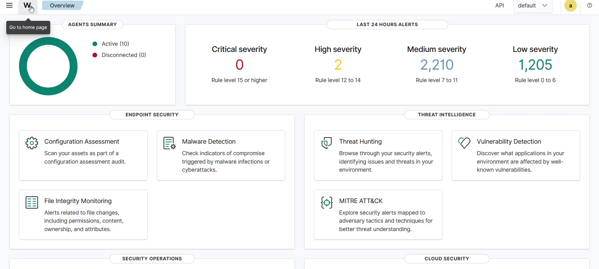
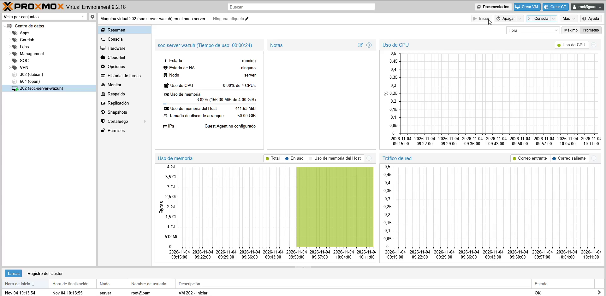
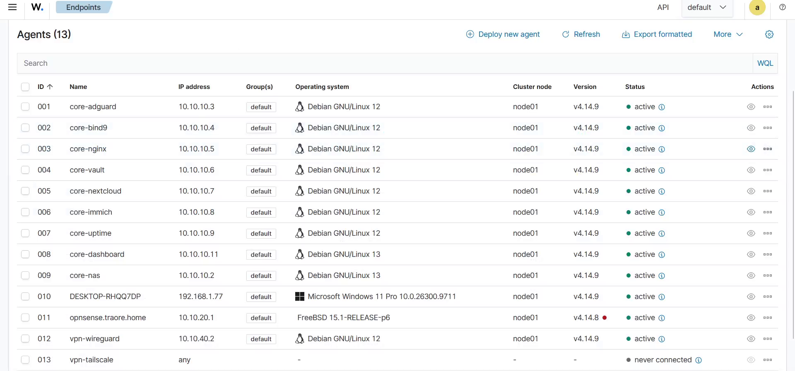
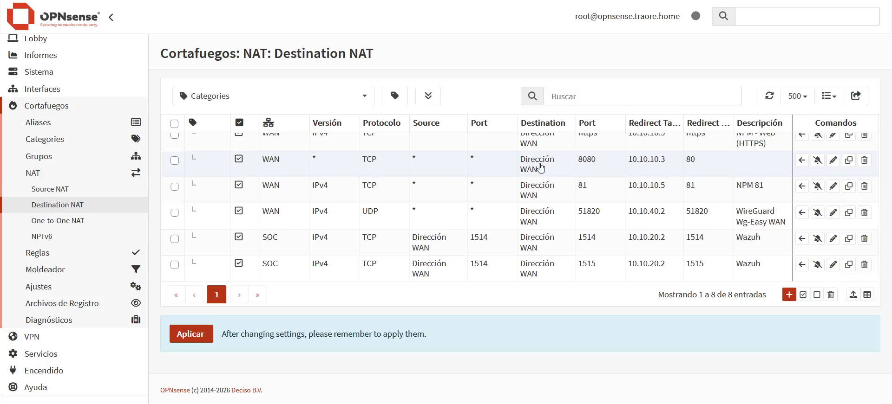
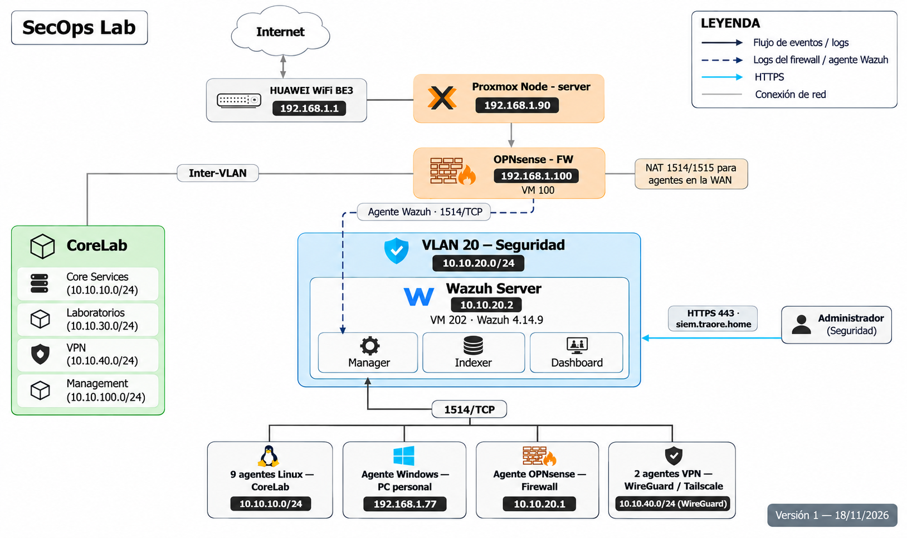

# SecOps Lab

> Laboratorio personal de operaciones de seguridad — monitorización, detección y análisis de la infraestructura CoreLab.

> **Estado:** 🟢 Activo — desarrollo continuo


---

## Descripción

SecOps Lab es un laboratorio personal de operaciones de seguridad diseñado para monitorizar y analizar la infraestructura de **CoreLab**. Funciona como una capa de seguridad sobre la infraestructura existente: recopila eventos, correlaciona actividad y genera alertas a partir de los sistemas monitorizados.

La primera versión se centra en **Wazuh** como plataforma central de monitorización. Otros componentes —detección de red, automatización de workflows, análisis asistido mediante IA local y notificaciones— se incorporarán en fases posteriores, una vez implementados y verificados.

El objetivo es construir un entorno práctico para aprender y experimentar con monitorización de seguridad, detección de amenazas, análisis de eventos y automatización de respuestas.



*Vista general del dashboard: estado de los agentes y alertas de las últimas 24 horas.*

<p align="center">
  
  
  
</p>

*Servidor Wazuh en Proxmox, agentes registrados y reglas NAT en OPNsense.*

---

## Índice

- [Arquitectura](#arquitectura)
- [Infraestructura](#infraestructura)
- [Agentes monitorizados](#agentes-monitorizados)
- [Tecnologías](#tecnologías)
- [Documentación](#documentación)
- [Estructura del repositorio](#estructura-del-repositorio)
- [Roadmap](#roadmap)
- [Consideraciones de seguridad](#consideraciones-de-seguridad)

---

## Arquitectura

SecOps Lab se integra en la VLAN de seguridad de CoreLab (`10.10.20.0/24`) y recibe eventos de los endpoints a través de OPNsense. El manager centraliza la recogida de logs, la correlación de reglas y la generación de alertas.



*Arquitectura actual: VLAN 20 de seguridad, Wazuh y los 13 agentes monitorizados.*

El flujo de eventos y el detalle de los componentes están documentados en [`docs/architecture.md`](docs/architecture.md).

---

## Infraestructura

| Componente | Detalle |
|---|---|
| **Hipervisor** | Proxmox VE 9.2.18 (nodo `server`) |
| **VM del SIEM** | `202` — `soc-server-wazuh` |
| **Recursos** | 4 vCPU · 4 GB RAM · 50 GB disco |
| **Sistema base** | Debian 13 (*trixie*) |
| **Plataforma** | Wazuh 4.14.9 (indexer, manager y dashboard) |
| **IP del manager** | `10.10.20.2` |
| **Dashboard** | `https://siem.traore.home` (HTTPS/443) |
| **Puertos de agentes** | `1514/TCP` (eventos) y `1515/TCP` (registro) |

La comunicación de los agentes atraviesa OPNsense mediante reglas **Destination NAT**. Los detalles están en [`docs/network.md`](docs/network.md).

---

## Agentes monitorizados

Actualmente hay **13 agentes registrados**: 12 activos y `vpn-tailscale` pendiente de conexión.

| ID | Agente | IP | Sistema operativo | Estado |
|---|---|---|---|---|
| 001 | `core-adguard` | 10.10.10.3 | Debian 12 | ✅ Activo |
| 002 | `core-bind9` | 10.10.10.4 | Debian 12 | ✅ Activo |
| 003 | `core-nginx` | 10.10.10.5 | Debian 12 | ✅ Activo |
| 004 | `core-vault` | 10.10.10.6 | Debian 12 | ✅ Activo |
| 005 | `core-nextcloud` | 10.10.10.7 | Debian 12 | ✅ Activo |
| 006 | `core-immich` | 10.10.10.8 | Debian 12 | ✅ Activo |
| 007 | `core-uptime` | 10.10.10.9 | Debian 12 | ✅ Activo |
| 008 | `core-dashboard` | 10.10.10.11 | Debian 13 | ✅ Activo |
| 009 | `core-nas` | 10.10.10.2 | Debian 13 | ✅ Activo |
| 010 | `DESKTOP-RHQ7Q7DP` | 192.168.1.77 | Windows 11 Pro | ✅ Activo |
| 011 | `opnsense.traore.home` | 10.10.20.1 | FreeBSD 15.1 | ✅ Activo |
| 012 | `vpn-wireguard` | 10.10.40.2 | Debian 12 | ✅ Activo |
| 013 | `vpn-tailscale` | 10.10.40.3 | — | ✅ Activo |

La instalación y el registro de cada tipo de agente se documentan en [`docs/despliegue-agentes.md`](docs/despliegue-agentes.md).

---

## Tecnologías

| Tecnología | Versión | Función |
|---|---|---|
| **Wazuh** | 4.14.9 | SIEM: recogida de eventos, correlación, alertas, FIM, SCA y detección de vulnerabilidades |
| **Proxmox VE** | 9.2.18 | Virtualización del servidor de monitorización |
| **Debian** | 13 (*trixie*) | Sistema operativo del servidor Wazuh |
| **OPNsense** | — | Firewall, router inter-VLAN y NAT de los puertos de agentes |
| **FreeBSD** | 15.1 | Sistema operativo del firewall monitorizado |
| **Windows 11 Pro** | 10.0.26300.9711 | Endpoint de escritorio monitorizado |

---

## Documentación

| Documento | Contenido |
|---|---|
| [Arquitectura de SecOps Lab](docs/architecture.md) | Componentes, flujo de eventos y alcance del laboratorio |
| [Instalación de Wazuh](docs/installation.md) | Despliegue *todo en uno* en una VM de Proxmox |
| [Despliegue de agentes](docs/despliegue-agentes.md) | Registro y configuración en Linux, Windows y OPNsense |
| [Red y conectividad](docs/network.md) | Reglas NAT, puertos requeridos y comprobaciones |
| [Dashboard y detección](docs/dashboard.md) | Overview, Discover, vulnerabilidades y SCA |
| [Resolución de problemas](docs/troubleshooting.md) | Incidencias encontradas y soluciones aplicadas |

Las capturas de cada fase están disponibles en [`screenshots/`](screenshots/).

---

## Estructura del repositorio

```text
secops-lab/
├── README.md
├── docs/
│   ├── architecture.md
│   ├── installation.md
│   ├── despliegue-agentes.md
│   ├── network.md
│   ├── dashboard.md
│   └── troubleshooting.md
├── screenshots/
│   ├── architecture/
│   ├── install/
│   ├── agents/
│   ├── dashboard/
│   ├── network/
│   └── troubleshooting/
├── wazuh/
│   └── rules/
└── dashboards/
    ├── grafana/
    └── wazuh/
```

La estructura se ampliará a medida que se incorporen reglas personalizadas, dashboards y nuevas fuentes de eventos.

---

## Roadmap

### Fase 1 — Monitorización de CoreLab

- [x] Definir la arquitectura inicial
- [x] Desplegar Wazuh en modo *todo en uno*
- [x] Registrar agentes Linux, Windows y OPNsense
- [x] Publicar los puertos de agentes mediante NAT en OPNsense
- [x] Documentar la instalación, el despliegue de agentes y los dashboards
- [ ] Configurar monitorización avanzada
- [ ] Realizar pruebas de seguridad controladas
- [ ] Documentar investigaciones

### Fase 2 — Ampliación

- [ ] Integrar Suricata (detección de red)
- [ ] Configurar n8n (automatización de workflows)
- [ ] Integrar Ollama (análisis asistido mediante IA local)
- [ ] Integrar Telegram (notificaciones)
- [ ] Ampliar fuentes de eventos y reglas de detección

### Futuro

La integración con otros entornos, como un laboratorio de Active Directory y sistemas Windows, se realizará en fases posteriores. Estas funcionalidades no forman parte del alcance actual de SecOps Lab.

---

## Consideraciones de seguridad

SecOps Lab monitoriza una infraestructura personal y debe mantenerse correctamente aislado.

El proyecto no debe contener:

- Contraseñas
- API keys
- Tokens
- Credenciales
- Información privada
- Configuraciones sensibles

Las pruebas de seguridad deben realizarse únicamente contra sistemas propios o entornos sobre los que exista autorización explícita.

---

<div align="center">

**Última actualización:** 19/11/2026

---

### Author

**Amadou Traore Keita**

ASIR Student · Cloud · Cybersecurity · Systems Administration

[](https://www.linkedin.com/in/amtraorek/) [](mailto:amtraorek@gmail.com)

</div>
