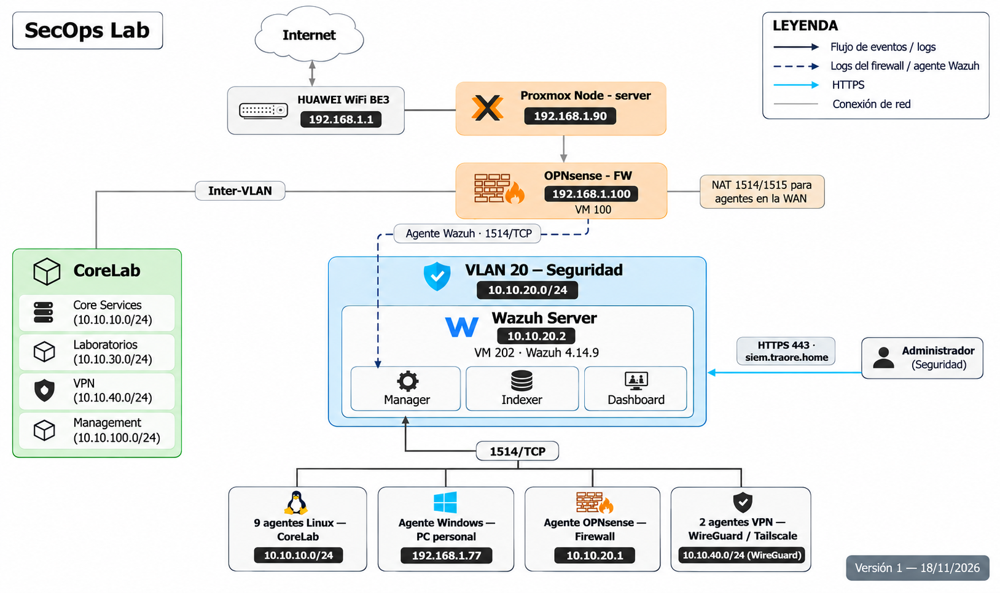

# Arquitectura de SecOps Lab

## Descripción

SecOps Lab actúa como la capa de seguridad y monitorización de **CoreLab**. Su diseño está enfocado en proporcionar visibilidad sobre la infraestructura mediante la recopilación, análisis y detección de eventos de seguridad.

El laboratorio se apoya en **Wazuh** como plataforma central de monitorización, complementada por dashboards y evidencias de despliegue, agentes y alertas.

## Objetivo

Proporcionar una plataforma centralizada que permita:

1. Recopilar los eventos generados por los sistemas de CoreLab.
2. Detectar cambios, accesos y comportamientos relevantes.
3. Evaluar la configuración y las vulnerabilidades de los endpoints.
4. Documentar evidencias y resultados de las pruebas realizadas en el laboratorio.

## Integración en la infraestructura

La plataforma de monitorización de SecOps Lab se despliega en la VLAN de seguridad de CoreLab (`10.10.20.0/24`):

| Elemento | Detalle |
|---|---|
| Hipervisor | Proxmox VE 9.2.18 (nodo `server`) |
| VM | `202` — `soc-server-wazuh` |
| Recursos | 4 vCPU · 4 GB RAM · 50 GB disco |
| Sistema base | Debian 13 (*trixie*) |
| Wazuh | 4.14.9 (indexer, manager y dashboard) |
| IP del manager | `10.10.20.2` |
| Dashboard | `https://siem.traore.home` (HTTPS/443) |
| Puertos de agentes | `1514/TCP` y `1515/TCP` |
| Red de laboratorio | VLAN 30 — `10.10.30.0/24` |
| VM objetivo | `305` — `lab-metasploitable2` (`10.10.30.5`) |
| VM de pruebas | `303` — `lab-pentesting-kali` (`10.10.30.3`) |
| Acceso RDP | `3389/TCP` publicado en OPNsense |

Los endpoints se comunican con el manager a través de OPNsense. Las reglas **Destination NAT** publican los puertos `1514/TCP` y `1515/TCP` para los agentes que se encuentran fuera de la VLAN de seguridad.

El laboratorio de pruebas se mantiene en una red separada (`10.10.30.0/24`) para no mezclar el tráfico de las pruebas con la infraestructura monitorizada. El acceso remoto a Kali se publica por RDP a través de OPNsense; Metasploitable 2 no se expone fuera de la VLAN de laboratorio.

## Diagrama de arquitectura



*Arquitectura actual de SecOps Lab: VLAN 20 de seguridad, Wazuh y los agentes monitorizados. El laboratorio de pruebas se detalla en [Laboratorio de pruebas](pentesting.md).*

## Componentes

1. **CoreLab (infraestructura monitorizada):**
   - Proxmox VE (virtualización).
   - OPNsense (firewall y router).
   - Sistemas Linux, contenedores y servicios autoalojados.

2. **Wazuh (plataforma de seguridad):**
   - Recopilación de logs y eventos del sistema.
   - Monitorización de integridad de archivos (FIM).
   - Generación de alertas basadas en reglas.
   - Gestión centralizada de agentes.
   - Detección de vulnerabilidades y evaluación de configuración (SCA).

3. **Dashboards:**
   - Visualización de alertas, eventos y estado de los agentes.
   - Paneles específicos de Wazuh y Grafana.

4. **Pruebas de seguridad e investigación:**
   - Ejecución controlada de pruebas sobre CoreLab.
   - Metasploitable 2 como objetivo vulnerable en la VLAN 30.
   - Kali Linux como estación de pruebas y acceso remoto por RDP.
   - Análisis y documentación de alertas e incidentes simulados.

## Flujo de eventos

1. El agente de cada endpoint recopila los eventos locales y los envía al manager por `1514/TCP`.
2. Wazuh procesa los eventos con sus decodificadores y reglas de detección.
3. Las alertas resultantes se indexan y se muestran en el dashboard.
4. Los módulos de FIM, SCA y Vulnerability Detection generan resultados adicionales por agente.
5. Las evidencias y conclusiones se documentan en este repositorio.

## Despliegue y evidencias

La documentación visual del laboratorio se organiza de la siguiente forma:

```text
screenshots/
├── architecture/     # Diagrama de arquitectura
├── install/          # Instalación y puesta en marcha de Wazuh
├── agents/           # Registro y estado de los agentes
├── dashboard/        # Alertas, eventos y paneles de visualización
├── network/          # Reglas NAT y conectividad en OPNsense
├── pentesting/       # Metasploitable 2 y Kali Linux
└── troubleshooting/  # Incidencias y resolución
```

Las reglas personalizadas se almacenan en [`wazuh/rules/`](../wazuh/rules/) y los dashboards en [`dashboards/`](../dashboards/).

## Alcance actual

La primera versión se centra en la monitorización de CoreLab mediante Wazuh. El laboratorio de pruebas con Metasploitable 2 y Kali Linux se incorpora como un entorno aislado para validar detecciones y practicar pruebas controladas. Componentes adicionales como detección de red, automatización de workflows, análisis asistido mediante IA local y notificaciones se incorporarán en fases posteriores, una vez implementados y verificados.

## Documentación relacionada

- [Laboratorio de pruebas](pentesting.md)
- [Instalación de Wazuh](installation.md)
- [Despliegue de agentes](despliegue-agentes.md)
- [Red y conectividad](network.md)
- [Dashboard y detección](dashboard.md)
- [Resolución de problemas](troubleshooting.md)
