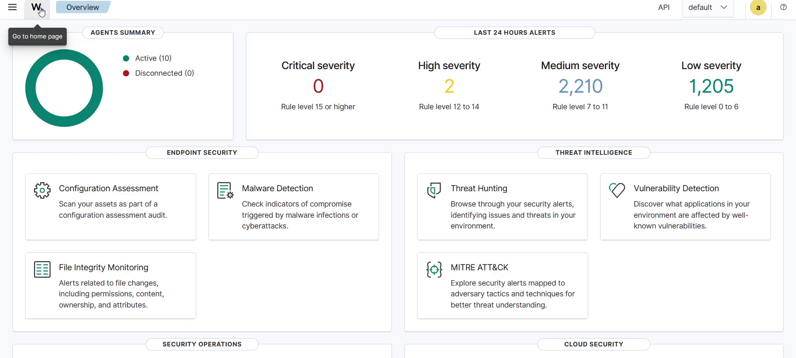
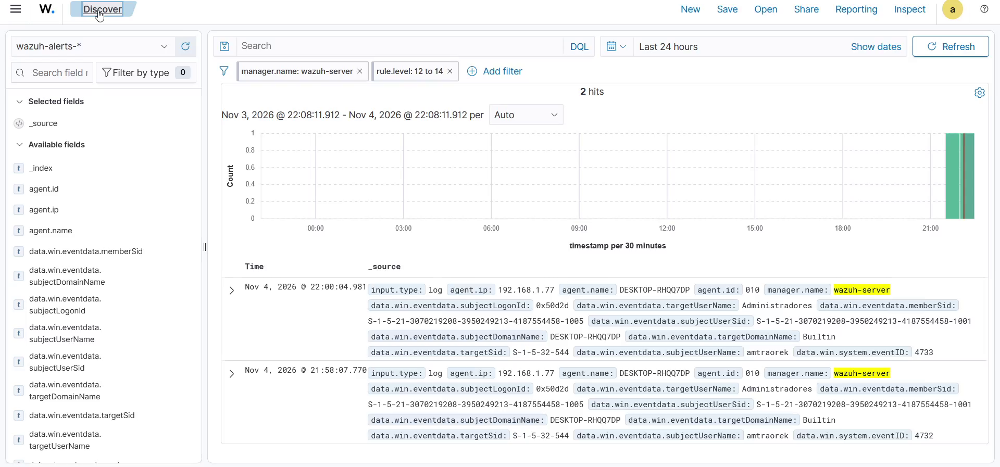
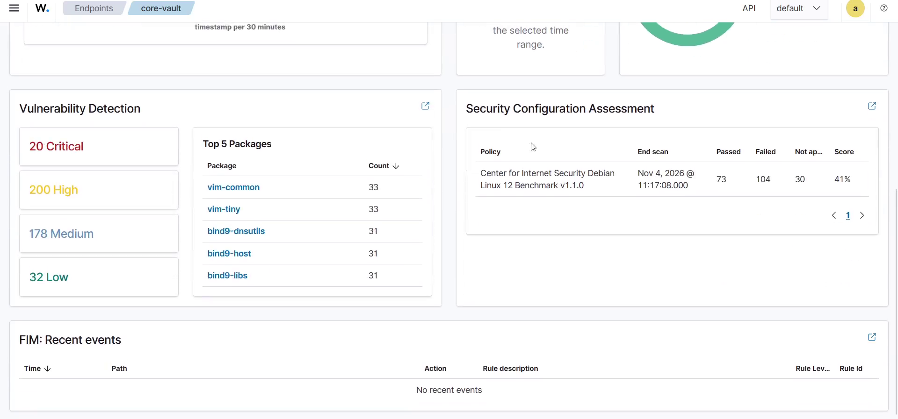

# Dashboard y detección

## Descripción

El dashboard de Wazuh centraliza el estado de los agentes, las alertas y los resultados de los módulos de detección. Las capturas corresponden a la sesión del **4 de noviembre de 2026**.

## Objetivo

Proporcionar una vista operativa del laboratorio para revisar el estado de los endpoints, investigar eventos, consultar vulnerabilidades y evaluar la configuración de los sistemas monitorizados.

## Integración en la infraestructura

El dashboard se publica por HTTPS en `https://siem.traore.home` y consume los datos del manager Wazuh `10.10.20.2`. Los agentes aparecen en **Endpoints** y sus eventos se indexan en los índices `wazuh-alerts-*` y `wazuh-archives-*`.

## Vistas principales

### Vista general

*Resumen de agentes y alertas de las últimas 24 horas.*

La pantalla principal muestra:

- **Agents summary:** agentes activos y desconectados.
- **Last 24 hours alerts:** alertas agrupadas por severidad (crítica, alta, media y baja).
- **Endpoint security:** Configuration Assessment, Malware Detection y File Integrity Monitoring.
- **Threat intelligence:** Threat Hunting, Vulnerability Detection y MITRE ATT&CK.
- **Security operations / Cloud security:** módulos de cumplimiento y servicios cloud.

En la captura no hay alertas críticas y sí un pequeño número de alertas de severidad alta, junto con actividad de severidad media y baja generada por los propios sistemas monitorizados.

### Threat Hunting (Discover)

La vista **Discover** permite consultar los eventos indexados y filtrar por cualquier campo. En la captura se filtra por `manager.name: wazuh-server` y `rule.level: 12 to 14` (severidad alta):

*Dos eventos de severidad alta del endpoint Windows `DESKTOP-RHQ7Q7DP`.*

Los documentos muestran campos como:

- `agent.name`, `agent.ip` y `agent.id`.
- `rule.description`, `rule.id` y `rule.level`.
- `data.win.eventdata.*`, con el usuario, dominio y SID del evento de Windows.

Este tipo de consulta es la base para investigar alertas y correlacionar actividad entre endpoints.

### Vulnerabilidades y configuración

El módulo **Vulnerability Detection** permite revisar los paquetes afectados por CVE, mientras que **Security Configuration Assessment (SCA)** evalúa el cumplimiento de una política de configuración. La siguiente vista está filtrada por el agente `core-vault` (004):

*Vista del agente `core-vault`: vulnerabilidades por severidad, paquetes más afectados, SCA y eventos FIM.*

Datos visibles en la captura:

- **20** vulnerabilidades críticas, **200** altas, **178** medias y **32** bajas.
- Paquetes con más hallazgos: `vim-common` (33), `vim-tiny` (33), `bind9-dnsutils` (31), `bind9-host` (31) y `bind9-libs` (31).
- SCA: política *CIS Debian Linux 12 Benchmark v1.1.0*, con 73 controles superados, 104 fallidos y una puntuación del 41 %.
- FIM: sin eventos recientes en el periodo consultado.

> Al estar filtrada por un agente, esta vista no representa el total del laboratorio. Para revisar el resto de endpoints hay que cambiar el filtro de agente en el dashboard.

### MITRE ATT&CK y cumplimiento

El detalle de cada agente incluye un resumen de **MITRE ATT&CK** (tácticas detectadas) y de **Compliance** (por ejemplo, PCI DSS). En la captura del agente OPNsense aparece la táctica *Defense Evasion* y los controles PCI DSS evaluados.

El módulo **MITRE ATT&CK** del dashboard permite profundizar en las técnicas asociadas a las alertas y sirve de apoyo para explicar el contexto de una detección.

## Documentación relacionada

- [Arquitectura de SecOps Lab](architecture.md)
- [Instalación de Wazuh](installation.md)
- [Despliegue de agentes](despliegue-agentes.md)
- [Red y conectividad](network.md)
- [Resolución de problemas](troubleshooting.md)
