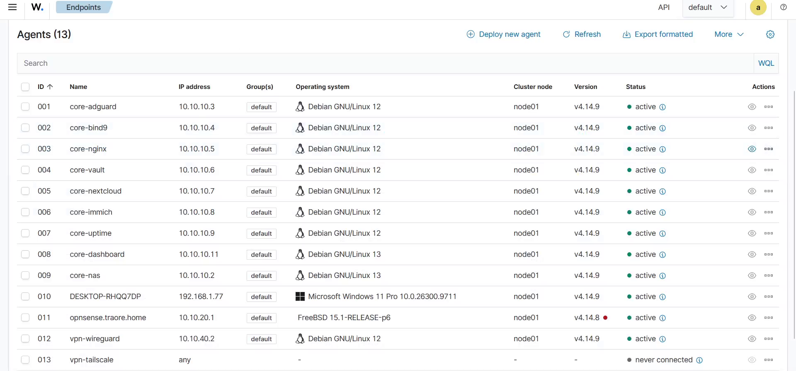
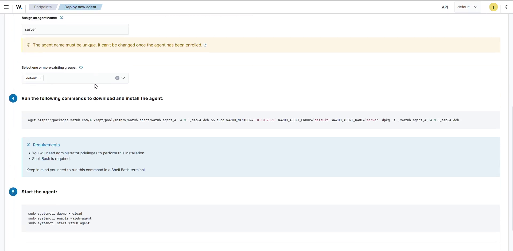
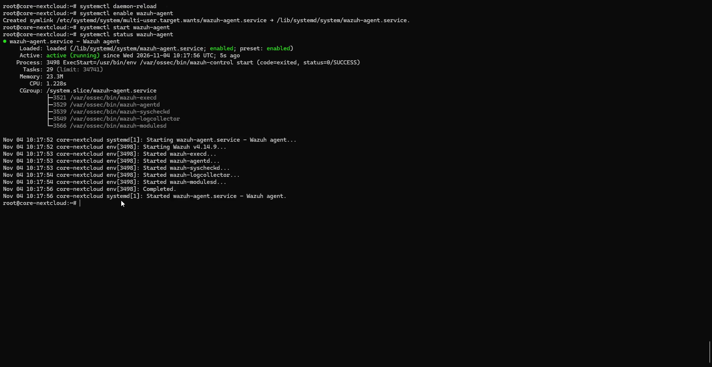
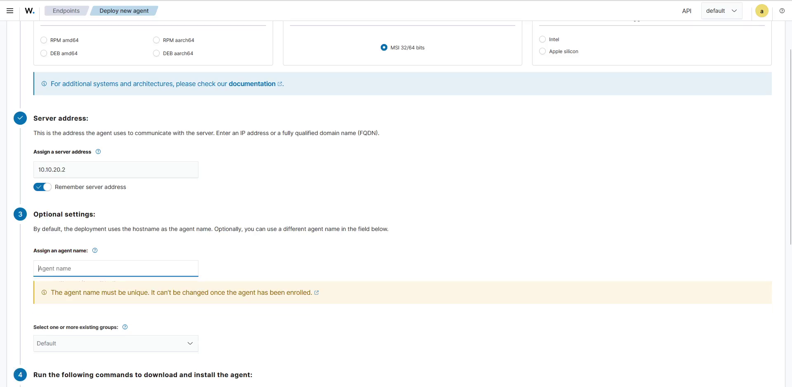
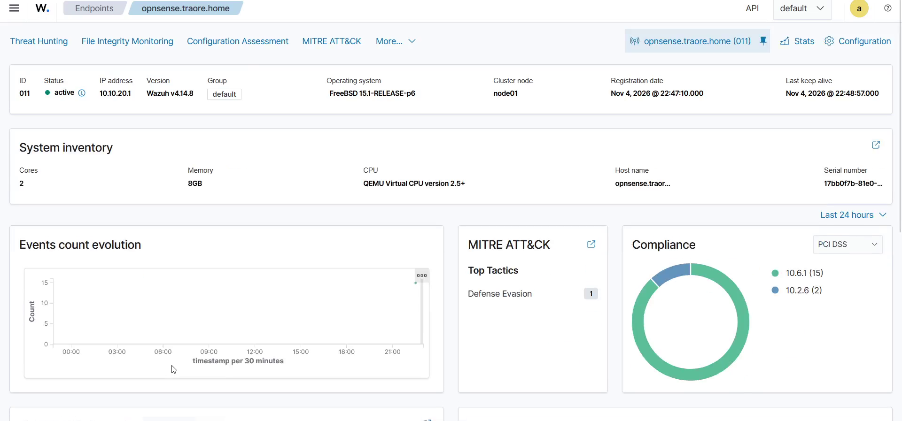

# Despliegue de agentes

## Descripción

Los agentes de Wazuh recopilan los eventos de los sistemas de CoreLab y los envían al manager `10.10.20.2`. El despliegue se realizó desde el asistente **Endpoints → Deploy new agent** del dashboard.

## Objetivo

Registrar y configurar los endpoints de CoreLab —servidores Linux, un escritorio Windows y el firewall OPNsense— para que envíen sus eventos al SIEM y aparezcan como agentes activos.

## Integración en la infraestructura

En la última captura del laboratorio aparecen **13 agentes registrados**:

- Nodos Linux Debian 12/13 (`core-adguard`, `core-bind9`, `core-nginx`, `core-vault`, `core-nextcloud`, `core-immich`, `core-uptime`, `core-dashboard`, `core-nas`).
- Un endpoint Windows 11 (`DESKTOP-RHQ7Q7DP`).
- El firewall OPNsense (`opnsense.traore.home`, FreeBSD).
- Dos agentes de VPN (`vpn-wireguard` y `vpn-tailscale`).



*Listado de agentes con su IP, sistema operativo, versión y estado.*

## Configuración

### Despliegue desde el dashboard

1. Abrir **Endpoints → Deploy new agent**.
2. Seleccionar el sistema operativo y la arquitectura del endpoint (DEB, RPM, MSI, etc.).
3. Indicar la dirección del manager: `10.10.20.2`.
4. Asignar un nombre de agente único y el grupo `default`.
5. Ejecutar el comando que genera el asistente en el endpoint.
6. Arrancar el servicio y comprobar que el agente aparece como `active`.

### Linux (paquete DEB)



*Asistente de despliegue para Linux con el manager `10.10.20.2` y el nombre de agente `server`.*

Comando de instalación generado por el asistente:

```bash
wget https://packages.wazuh.com/4.x/apt/pool/main/w/wazuh-agent/wazuh-agent_4.14.9-1_amd64.deb && \
sudo WAZUH_MANAGER='10.10.20.2' \
     WAZUH_AGENT_GROUP='default' \
     WAZUH_AGENT_NAME='server' \
     dpkg -i ./wazuh-agent_4.14.9-1_amd64.deb
```

Arranque y comprobación del servicio:

```bash
sudo systemctl daemon-reload
sudo systemctl enable wazuh-agent
sudo systemctl start wazuh-agent
systemctl status wazuh-agent
```



*Servicio `wazuh-agent` activo en `core-nextcloud` tras el despliegue.*

### Windows (paquete MSI)



*Asistente de despliegue para Windows con la arquitectura MSI 32/64 bits seleccionada.*

Instalación desatendida observada en el laboratorio:

```powershell
Invoke-WebRequest -Uri https://packages.wazuh.com/4.x/windows/wazuh-agent-4.14.9-1.msi -OutFile "$env:tmp/wazuh-agent.msi"

Start-Process msiexec.exe -Wait -ArgumentList '/i', "$env:tmp/wazuh-agent.msi", `
  '/q', '/l*v', "$env:tmp/wazuh-install.log", `
  'WAZUH_MANAGER=10.10.20.2', `
  'WAZUH_AGENT_GROUP=default', `
  'WAZUH_AGENT_NAME=lenovo_ideapad'

Start-Service WazuhSvc
Get-Service WazuhSvc
```

> El nombre `lenovo_ideapad` se usó durante las pruebas. En el listado final el endpoint Windows aparece como `DESKTOP-RHQ7Q7DP`. Si el servicio no arranca, revisar la sección de [resolución de problemas](troubleshooting.md#windows-el-servicio-del-agente-no-arranca).

### OPNsense (FreeBSD)

El firewall se monitoriza con el agente `opnsense.traore.home` (FreeBSD 15.1, Wazuh 4.14.8). El agente se instaló como paquete de OPNsense y se habilitó en `/etc/rc.conf`:

```text
wazuh_agent_enable="YES"
```

Arranque del servicio:

```bash
service wazuh-agent start
```



*Detalle del agente de OPNsense: estado, versión, inventario del sistema y resumen MITRE/PCI DSS.*

> La línea `sysrc wazuh_agent_enable="YES"` debe ejecutarse como comando, no escribirse dentro de `rc.conf`. Ver [resolución de problemas](troubleshooting.md#opnsense-línea-incorrecta-en-rcconf).

## Verificación

- El agente debe aparecer en **Endpoints** con estado `active`.
- El detalle del agente muestra IP, sistema operativo, versión, última conexión e inventario.
- Si no conecta, comprobar la ruta y los puertos hacia el manager:

```powershell
Test-NetConnection 10.10.20.2 -Port 1514
```

## Documentación relacionada

- [Arquitectura de SecOps Lab](architecture.md)
- [Instalación de Wazuh](installation.md)
- [Red y conectividad](network.md)
- [Dashboard y detección](dashboard.md)
- [Resolución de problemas](troubleshooting.md)
