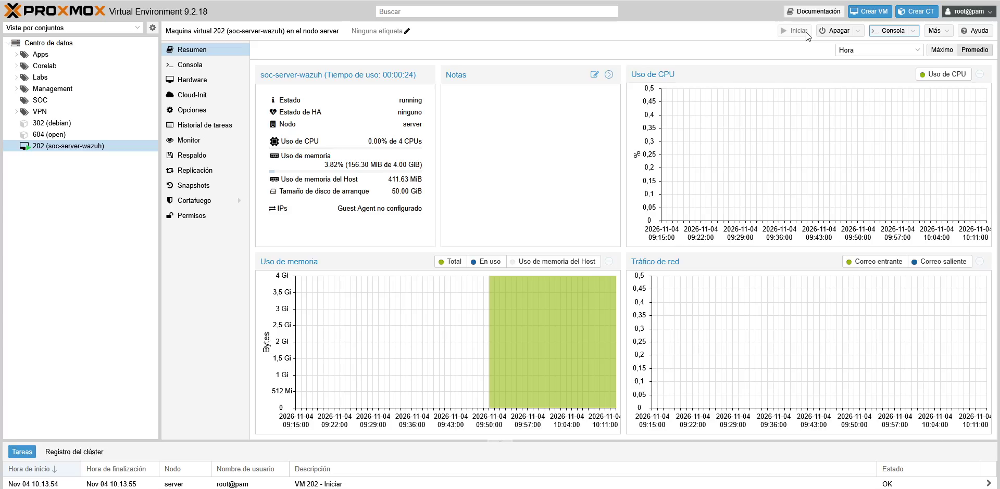
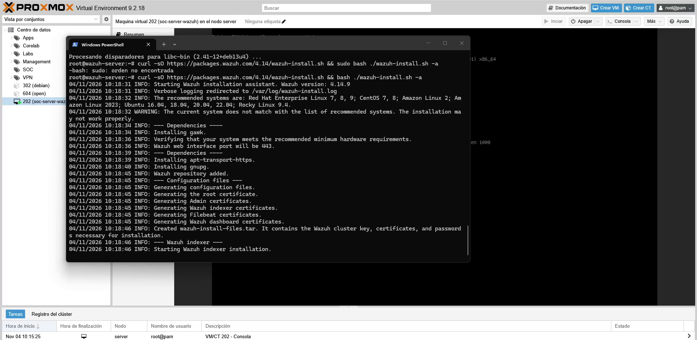
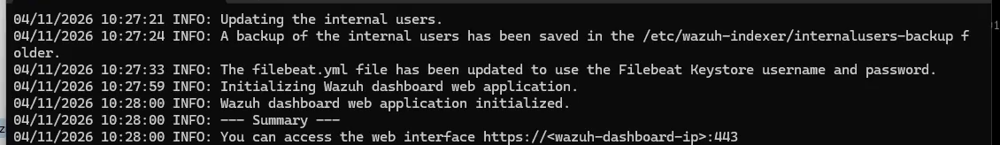
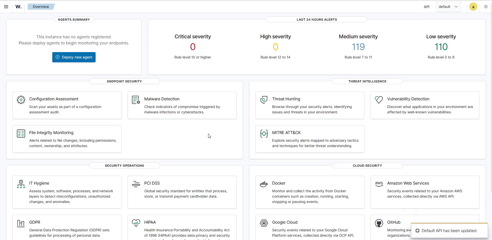

# Instalación de Wazuh

## Descripción

Documentación del despliegue inicial del servidor Wazuh de SecOps Lab, realizado el **4 de noviembre de 2026** sobre la infraestructura de CoreLab. Se instaló Wazuh en modo *todo en uno* (indexer, manager y dashboard) en una máquina virtual de Proxmox.

## Objetivo

Desplegar la plataforma central de monitorización del laboratorio: recogida de eventos, correlación, generación de alertas y publicación de dashboards para el análisis de seguridad.

## Integración en la infraestructura

| Recurso | Valor |
|---|---|
| Hipervisor | Proxmox VE 9.2.18 (nodo `server`) |
| VM | `202` — `soc-server-wazuh` |
| vCPU | 4 |
| Memoria | 4 GB |
| Disco | 50 GB |
| Sistema base | Debian 13 (*trixie*) |
| IP del servidor | `10.10.20.2` |
| Dashboard | HTTPS (443) |
| Puertos de agentes | 1514/TCP y 1515/TCP |



*VM `soc-server-wazuh` en ejecución dentro de Proxmox VE.*

El servidor se ubica en la VLAN de seguridad (`10.10.20.0/24`) y publica los puertos de agentes mediante NAT en OPNsense. La configuración de red se detalla en [`network.md`](network.md).

## Configuración

### Instalación todo en uno

La instalación se realizó con el asistente oficial de Wazuh desde una sesión de `root`:

```bash
curl -sO https://packages.wazuh.com/4.14/wazuh-install.sh
bash ./wazuh-install.sh -a
```



*Descarga del instalador y comienzo de la instalación de Wazuh 4.14.9.*

Notas de la sesión:

- El primer intento se lanzó con `sudo`, pero la VM no lo tiene instalado (`sudo: orden no encontrada`). Al estar conectado como `root`, se ejecutó el script directamente.
- El instalador avisó de que Debian 13 no figuraba entre los sistemas recomendados en ese momento. Aun así, la instalación finalizó correctamente.
- El asistente instala y arranca `wazuh-indexer`, `wazuh-manager`, `filebeat` y `wazuh-dashboard`.

### Resumen de la instalación

Al finalizar, el instalador muestra la URL del dashboard y genera las credenciales del usuario `admin`.



*Resumen del instalador: el dashboard queda disponible en `https://<wazuh-dashboard-ip>:443`.*

Las contraseñas generadas **no se almacenan en este repositorio**. En el laboratorio se cambió la contraseña de `admin` después de la instalación con la herramienta oficial:

```bash
curl -so wazuh-passwords-tool.sh https://packages.wazuh.com/4.14/wazuh-passwords-tool.sh
bash wazuh-passwords-tool.sh -u admin -p '<NUEVA_CONTRASEÑA>'
```

> Sustituir `<NUEVA_CONTRASEÑA>` por una contraseña robusta y guardarla en un gestor de secretos, nunca en el repositorio.

### Primer acceso al dashboard

El dashboard se publica por HTTPS en `https://10.10.20.2` (certificado autofirmado; el navegador muestra el aviso de conexión no segura). En capturas posteriores también aparece accesible mediante el nombre `siem.traore.home`.



*Primer acceso: el dashboard aún no tiene agentes registrados e invita a desplegar el primero.*

## Verificación

- El dashboard responde y permite iniciar sesión con el usuario `admin`.
- El servidor escucha en los puertos de agentes (1514/TCP y 1515/TCP), que se publican mediante NAT en OPNsense.
- Los agentes dados de alta se conectan al manager `10.10.20.2` y aparecen como `active`.

## Incidencias

| Incidencia | Resolución |
|---|---|
| `sudo: orden no encontrada` | Ejecutar como `root` o instalar `sudo` en el sistema base. |
| Aviso de sistema no recomendado | La instalación continuó y terminó correctamente; se validó con el acceso al dashboard. |
| Certificado autofirmado en el dashboard | Aceptar la excepción en el navegador o instalar un certificado válido. |

## Documentación relacionada

- [Arquitectura de SecOps Lab](architecture.md)
- [Despliegue de agentes](despliegue-agentes.md)
- [Red y conectividad](network.md)
- [Dashboard y detección](dashboard.md)
- [Resolución de problemas](troubleshooting.md)
