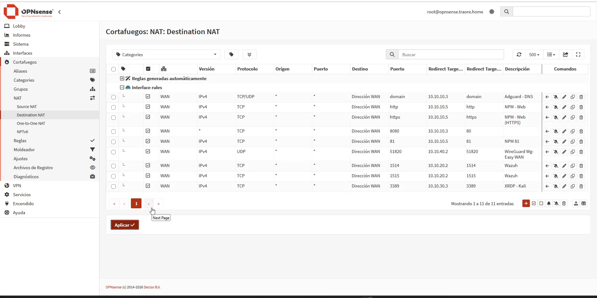
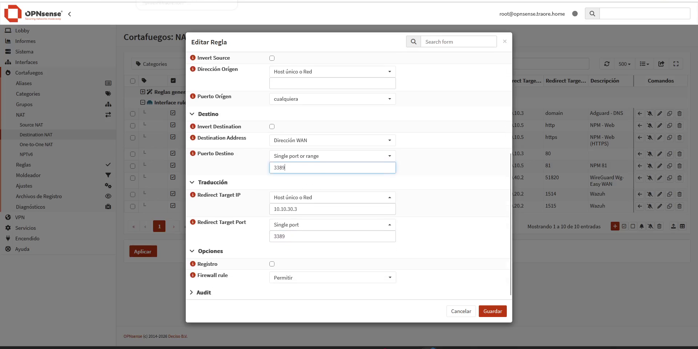
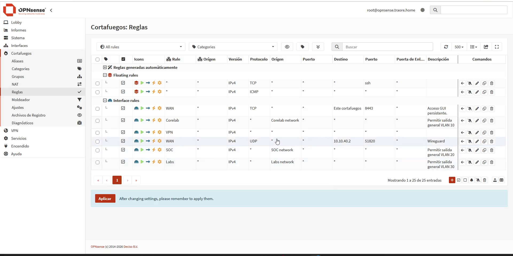

# Red y conectividad

## Descripción

La comunicación entre los agentes y el servidor Wazuh atraviesa OPNsense, el firewall de CoreLab. Para que los endpoints de otras redes puedan registrar y enviar eventos, se publican los puertos del manager mediante **Destination NAT**.

## Objetivo

Permitir que los agentes ubicados fuera de la VLAN de seguridad (`10.10.20.0/24`) alcancen el manager `10.10.20.2`, mantener el tráfico limitado a los puertos estrictamente necesarios y publicar el acceso RDP de la VM de pruebas en la VLAN de laboratorio.

## Integración en la infraestructura

SecOps Lab utiliza la VLAN de seguridad de CoreLab y se apoya en OPNsense para el filtrado y la traducción de direcciones:

```text
Agentes (WAN / otras VLAN)
            │
            ▼
        OPNsense
   Destination NAT
            │
            ▼
  Wazuh Manager 10.10.20.2
   1514/TCP · 1515/TCP
```

## Configuración

### Reglas NAT para Wazuh

En **Firewall → NAT → Destination NAT** se crearon dos reglas para el servidor `10.10.20.2`:

| Interfaz | Protocolo | Origen | Puerto | Destino | Redirección |
|---|---|---|---|---|---|
| SOC | TCP | WAN | 1514 | Dirección WAN | `10.10.20.2:1514` |
| SOC | TCP | WAN | 1515 | Dirección WAN | `10.10.20.2:1515` |


*Reglas Destination NAT con descripción «Wazuh» para los puertos 1514 y 1515.*

- **1514/TCP** transporta los eventos de los agentes.
- **1515/TCP** se utiliza para el registro de nuevos agentes.

> Tras crear o modificar las reglas hay que pulsar **Aplicar** en OPNsense para que los cambios entren en vigor.

### Regla NAT para Kali Linux (xrdp)

Para administrar la VM de pruebas desde la red de gestión se publica el puerto `3389/TCP` de Kali Linux. La regla se creó en **Firewall → NAT → Destination NAT**:

| Interfaz | Protocolo | Origen | Puerto | Destino | Redirección | Descripción |
|---|---|---|---|---|---|---|
| WAN | TCP | cualquiera | 3389 | Dirección WAN | `10.10.30.3:3389` | XRDP-Kali |



*Listado de Destination NAT con la regla `XRDP-Kali` hacia `10.10.30.3:3389`.*



*Detalle de la regla: puerto destino 3389 y redirección a `10.10.30.3:3389`.*

La regla se guardó con **Firewall rule: Permitir**, por lo que OPNsense generó automáticamente la regla de firewall asociada en la interfaz WAN. También se comprobó la regla de salida de la interfaz **Labs**:



*Regla «Permitir salida general VLAN 30» en la interfaz Labs.*

> El puerto 3389 queda accesible desde la WAN. En un entorno real debe limitarse el origen a la VPN o a una IP de confianza y no exponer RDP directamente a Internet. Metasploitable 2 no se publica; solo es accesible desde la VLAN 30.

### Puertos requeridos por Wazuh

Según la documentación oficial consultada durante el despliegue, Wazuh utiliza:

| Puerto | Uso |
|---|---|
| 1514/TCP | Comunicación de los agentes con el manager |
| 1515/TCP | Registro de agentes |
| 55000/TCP | API del manager |
| 443/TCP | Dashboard web |

En la captura inicial del laboratorio solo aparecían publicados por NAT los puertos de agentes (1514 y 1515). Posteriormente se añadió la regla `XRDP-Kali` para el puerto 3389. El dashboard se consume por HTTPS en `https://10.10.20.2` (o `siem.traore.home` en capturas posteriores).

### Acceso a OPNsense

La administración del firewall se realiza por HTTPS en `https://opnsense.traore.home`. El agente de OPNsense se conecta al manager por la red interna, por lo que no depende de las reglas NAT anteriores.

## Verificación

Desde un endpoint Windows se comprobó el puerto del manager:

```powershell
Test-NetConnection 10.10.20.2 -Port 1514
```

Si la conexión no se establece:

1. Verificar que la regla NAT está aplicada.
2. Revisar las reglas de firewall de la interfaz correspondiente.
3. Comprobar que el agente apunta a `10.10.20.2` y no a `0.0.0.0` (ver [resolución de problemas](troubleshooting.md#windows-el-servicio-del-agente-no-arranca)).

Para el acceso RDP al laboratorio, la comprobación se realiza contra la dirección WAN de OPNsense:

```powershell
Test-NetConnection 192.168.1.100 -Port 3389
```

Y desde Kali se confirma que xrdp escucha en el puerto:

```bash
nmap -p 3389 10.10.30.3
```

Si el puerto no aparece abierto, revisar en este orden: servicio `xrdp` en Kali, regla Destination NAT y regla de firewall de la interfaz WAN.

## Documentación relacionada

- [Arquitectura de SecOps Lab](architecture.md)
- [Laboratorio de pruebas](pentesting.md)
- [Instalación de Wazuh](installation.md)
- [Despliegue de agentes](despliegue-agentes.md)
- [Resolución de problemas](troubleshooting.md)
