# Laboratorio de pruebas

## Descripción

SecOps Lab incorpora un laboratorio de pruebas aislado para practicar pruebas de seguridad controladas y validar las detecciones de Wazuh. El entorno se compone de dos máquinas virtuales en la VLAN de laboratorio de CoreLab (`10.10.30.0/24`):

- **Metasploitable 2** como objetivo vulnerable.
- **Kali Linux** como estación de pruebas.

Ambas VMs se ejecutan en Proxmox VE y se conectan a la red mediante `vmbr1` con la etiqueta VLAN 30. El acceso gráfico remoto a Kali se publica a través de OPNsense mediante RDP.

> Metasploitable 2 es un sistema intencionadamente vulnerable. Solo debe utilizarse en una red aislada y nunca debe exponerse a Internet.

## Objetivo

Disponer de un entorno separado de la infraestructura monitorizada para ejecutar pruebas de seguridad, comprobar el alcance de las detecciones y documentar el despliegue y las incidencias encontradas.

## Integración en la infraestructura

| Elemento | Detalle |
|---|---|
| Hipervisor | Proxmox VE 9.2.18 (nodo `server`) |
| Red | VLAN 30 — `10.10.30.0/24` (`vmbr1`, tag 30) |
| Puerta de enlace | `10.10.30.1` (OPNsense) |
| VM objetivo | `305` — `lab-metasploitable2` · `10.10.30.5` |
| VM de pruebas | `303` — `lab-pentesting-kali` · `10.10.30.3` |
| Acceso remoto | RDP `3389/TCP` publicado en la WAN de OPNsense |

```text
Kali Linux 10.10.30.3 ──┐
                        ├── vmbr1 (VLAN 30) ── OPNsense 10.10.30.1
Metasploitable 2 10.10.30.5 ─┘
```

La VLAN 30 está separada de la VLAN de seguridad (`10.10.20.0/24`) donde reside Wazuh. El detalle de las reglas NAT y de firewall se documenta en [Red y conectividad](network.md).

## Configuración

### Metasploitable 2

Metasploitable 2 se desplegó como una VM independiente para disponer de un objetivo vulnerable dentro de la VLAN de laboratorio.

#### Creación de la VM

| Recurso | Valor |
|---|---|
| VM | `305` — `lab-metasploitable2` |
| Sistema | Linux 7.x — kernel 2.6 |
| vCPU | 1 |
| Memoria | 512 MB |
| Disco | 8 GB en `local-lvm` |
| Red | `vmbr1`, VLAN 30 |
| IP | `10.10.30.5/24` |

El asistente de Proxmox se utilizó para crear la VM vacía. El disco de Metasploitable 2 se importó después y se conectó a la VM. La configuración final se ajustó a 1 vCPU y 512 MB para reproducir el entorno original.

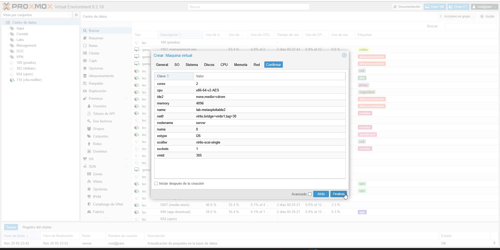

*Resumen del asistente: VM `305`, nombre `lab-metasploitable2`, 2 vCPU y 4 GB iniciales, red `vmbr1` con VLAN 30. El disco se importó después de crear la VM y la configuración final se ajustó a 1 vCPU y 512 MB.*

#### Intentos fallidos y corrección

Metasploitable 2 **se instaló y recreó varias veces porque el arranque fallaba**. No fue un único intento: se repitieron la creación de la VM, la importación del disco y el arranque, descartando las configuraciones que no llegaban al sistema. La VM `305` es el intento final que funciona.

En los intentos con el disco conectado como `scsi0` y controladora VirtIO SCSI, el arranque se detenía siempre en `initramfs`:

```text
ALERT! /dev/mapper/metasploitable-root does not exist. Dropping to a shell!
```

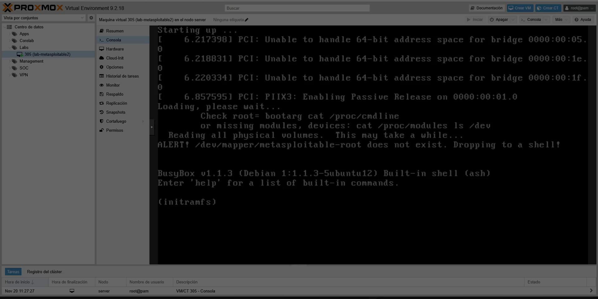

*El kernel 2.6 de Metasploitable 2 no encuentra el volumen raíz cuando el disco se presenta como SCSI.*

**Causa:** el kernel antiguo de Metasploitable 2 no reconoce el disco VirtIO SCSI con esta configuración. El volumen LVM no aparece y el arranque cae a la shell de `initramfs`.

**Resolución aplicada:** mover el disco de `scsi0` a `ide0`, eliminar el disco SCSI y arrancar desde IDE:

```bash
qm set 305 --ide0 local-lvm:vm-305-disk-0
qm set 305 --delete scsi0
qm set 305 --boot order=ide0
```

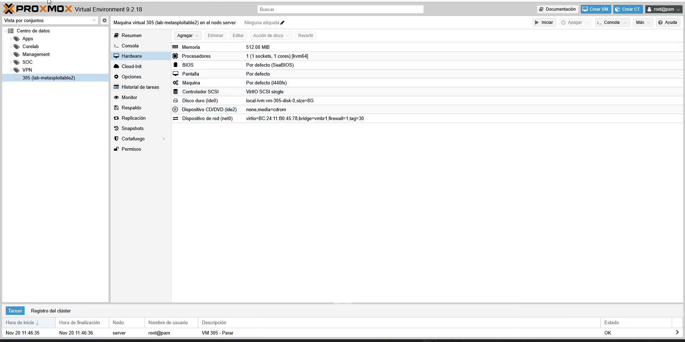

*Configuración final: disco `ide0` de 8 GB, 512 MB de memoria y red `vmbr1` con VLAN 30.*

Tras este cambio, la VM arrancó correctamente y se llegó al login de Metasploitable 2.

#### Configuración de red

La interfaz `eth0` se configuró con una dirección estática dentro de la VLAN 30:

```text
auto eth0
iface eth0 inet static
    address 10.10.30.5/24
    gateway 10.10.30.1
```

La configuración se aplicó reiniciando el servicio de red:

```bash
sudo /etc/init.d/networking restart
ip a
ping -c 3 10.10.10.3
```

El reinicio mostró el aviso `SIOCDELRT: No such process`, pero la interfaz quedó operativa. La dirección `10.10.30.5/24` aparece correctamente en `ip a` y el ping a un host de la VLAN de servicios responde.

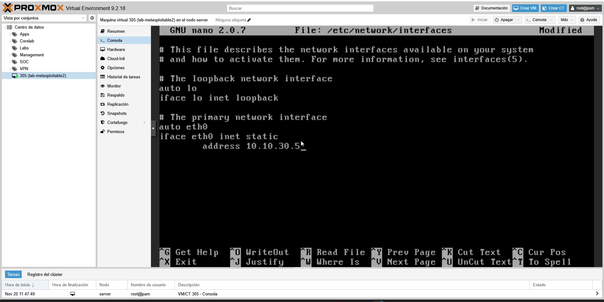

*Configuración de `eth0` con la dirección estática del laboratorio.*

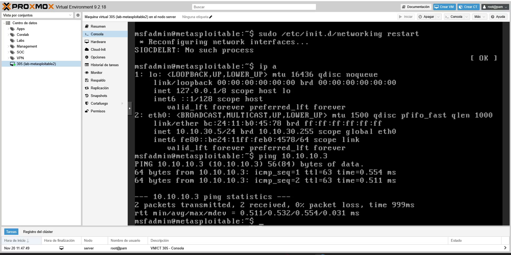

*La VM arranca, obtiene `10.10.30.5/24` y responde al ping de `10.10.10.3`.*

### Kali Linux

Kali Linux se instaló como la VM `303` (`lab-pentesting-kali`) para utilizarla como estación de pruebas. Se usó el instalador oficial en modo BIOS, con particionado guiado y GRUB en el disco de la VM.

| Recurso | Valor |
|---|---|
| VM | `303` — `lab-pentesting-kali` |
| Distribución | Kali Linux (*kali-rolling*) |
| IP | `10.10.30.3/24` |
| Puerta de enlace | `10.10.30.1` |
| Red | `vmbr1`, VLAN 30 |

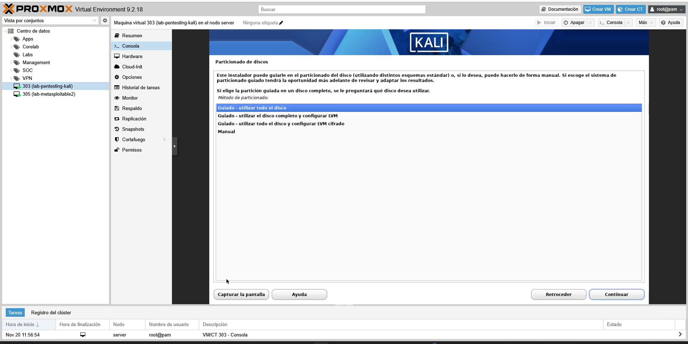

*Particionado guiado durante la instalación de Kali Linux.*

Después del primer arranque se comprobó la red y la salida a Internet:

```bash
ip a
ip route
ping -c 3 8.8.8.8
```

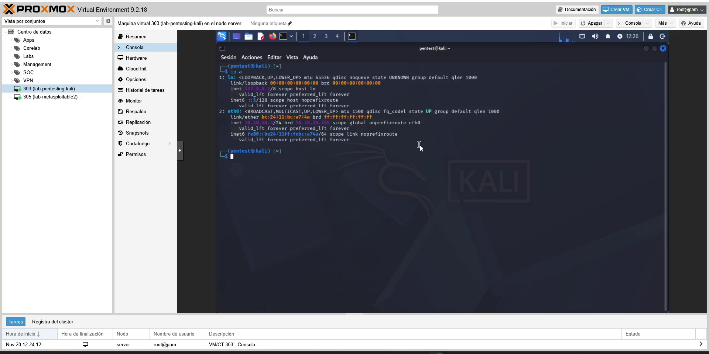

*Kali Linux con la dirección `10.10.30.3/24` en `eth0`.*

Las credenciales de la cuenta de laboratorio no se almacenan en este repositorio.

#### Instalación y habilitación de xrdp

Para habilitar el acceso gráfico remoto se instaló `xrdp`:

```bash
sudo apt update
sudo apt install -y xrdp
sudo systemctl enable --now xrdp
```

Tras la instalación, el servicio quedó como `disabled/static` y no escuchaba en el puerto 3389. Fue necesario habilitarlo explícitamente con `systemctl enable --now xrdp`.

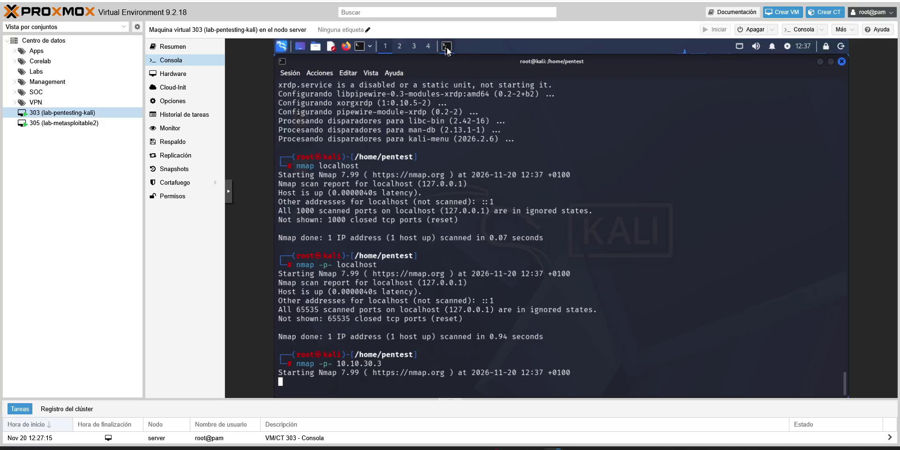

*Instalación de xrdp. En ese momento el servicio aún no estaba habilitado y `nmap` no mostraba el puerto 3389.*

Una vez habilitado, se comprobó que el puerto estaba a la escucha:

```bash
ss -tlnp | grep 3389
nmap -p 3389 10.10.30.3
```

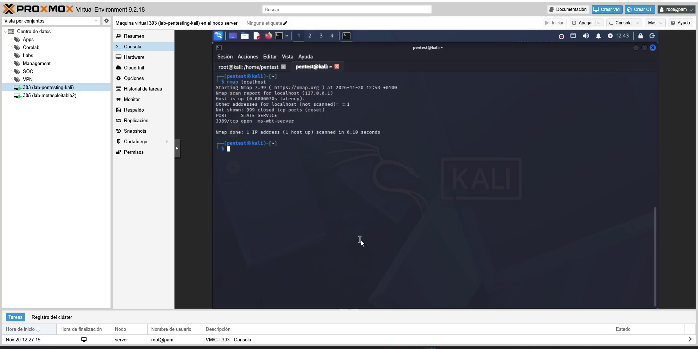

*`nmap` confirma `3389/tcp open` en Kali después de habilitar xrdp.*

#### Acceso desde Remmina

Desde un equipo Windows de la red de gestión se utilizó Remmina para conectarse a la dirección WAN de OPNsense (`192.168.1.100`) en el puerto `3389`. La regla NAT redirige la conexión a `10.10.30.3:3389`.

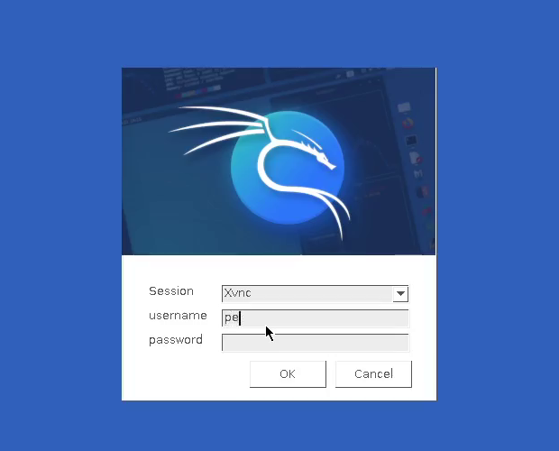

*Pantalla de login de xrdp con la sesión `Xvnc`.*


*Escritorio de Kali a través de RDP. Desde la sesión se comprueba la conectividad con Metasploitable 2 (`10.10.30.5`).*

### OPNsense: publicación de RDP

La regla se creó en **Firewall → NAT → Destination NAT**:

| Interfaz | Protocolo | Origen | Puerto | Destino | Redirección | Descripción |
|---|---|---|---|---|---|---|
| WAN | TCP | cualquiera | 3389 | Dirección WAN | `10.10.30.3:3389` | XRDP-Kali |

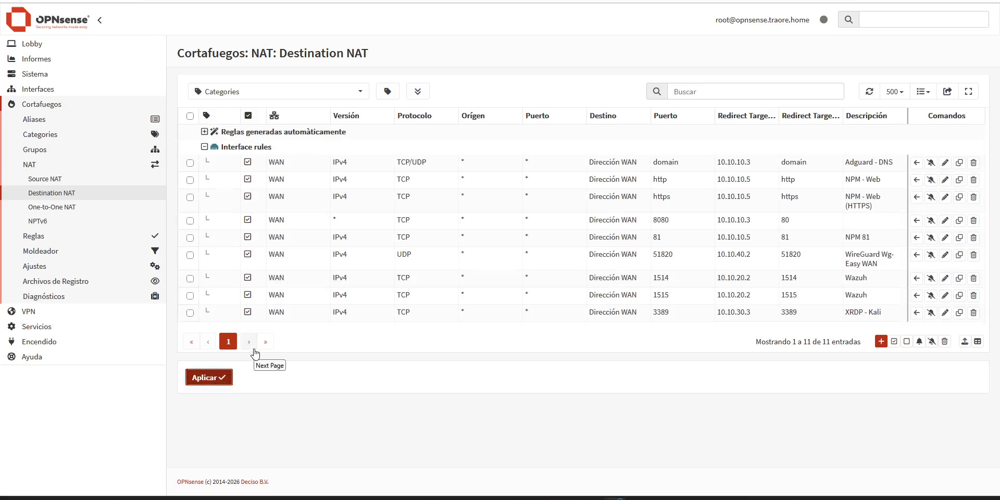

*Listado de Destination NAT con la regla `XRDP-Kali` hacia `10.10.30.3:3389`.*

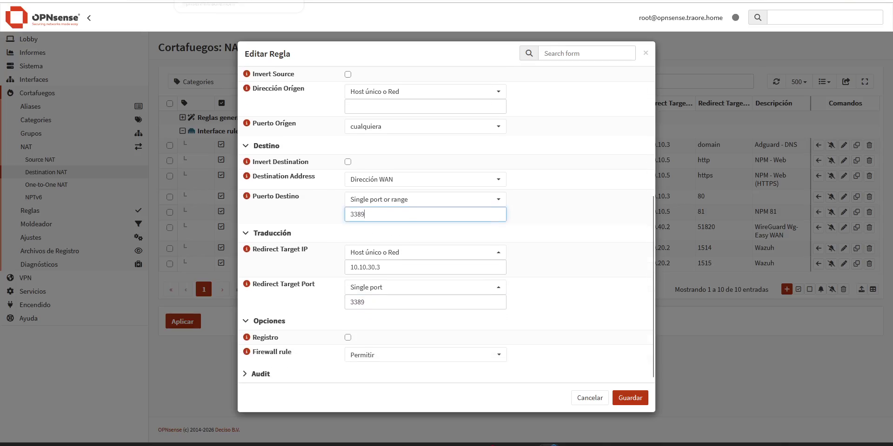

*Detalle de la regla: puerto destino 3389 y redirección a `10.10.30.3:3389`.*

La regla se guardó con **Firewall rule: Permitir**, lo que genera automáticamente la regla de firewall asociada en la interfaz WAN. Además, se comprobó la regla de salida de la interfaz **Labs**:

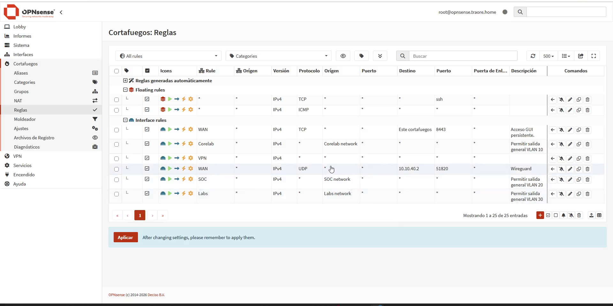

*Regla «Permitir salida general VLAN 30» en la interfaz Labs.*

> El puerto 3389 queda accesible desde la WAN. En un entorno real debe limitarse el origen a la VPN o a una IP de confianza, utilizar contraseñas robustas y no exponer RDP directamente a Internet. Metasploitable 2 no se publica; solo es accesible desde la VLAN 30.

## Verificación

- Metasploitable 2 arranca sin errores de `initramfs` y responde en `10.10.30.5`.
- Kali Linux arranca en `10.10.30.3/24` y tiene salida a Internet a través de `10.10.30.1`.
- `nmap -p 3389 10.10.30.3` devuelve `3389/tcp open`.
- La lista de Destination NAT de OPNsense muestra la regla `XRDP-Kali`.
- Remmina conecta con `192.168.1.100:3389` y abre el escritorio de Kali.
- La sesión RDP permite alcanzar Metasploitable 2 (`ping 10.10.30.5`).

## Incidencias

| Incidencia | Causa | Resolución |
|---|---|---|
| Metasploitable 2 se detiene en `initramfs` | El kernel 2.6 no reconoce el disco VirtIO SCSI | Mover el disco a IDE y arrancar con `boot order=ide0` |
| `SIOCDELRT: No such process` al reiniciar la red | Aviso del reinicio de `networking` | La interfaz queda operativa; validar con `ip a` y `ping` |
| xrdp no escucha en 3389 | El servicio quedó deshabilitado tras la instalación | `systemctl enable --now xrdp` |
| Kali no resuelve IPv6 en `apt update` | La VM no tiene conectividad IPv6 | El acceso IPv4 funciona; se validó con `ping 8.8.8.8` |

## Documentación relacionada

- [Arquitectura de SecOps Lab](architecture.md)
- [Red y conectividad](network.md)
- [Instalación de Wazuh](installation.md)
- [Despliegue de agentes](despliegue-agentes.md)
- [Resolución de problemas](troubleshooting.md)
