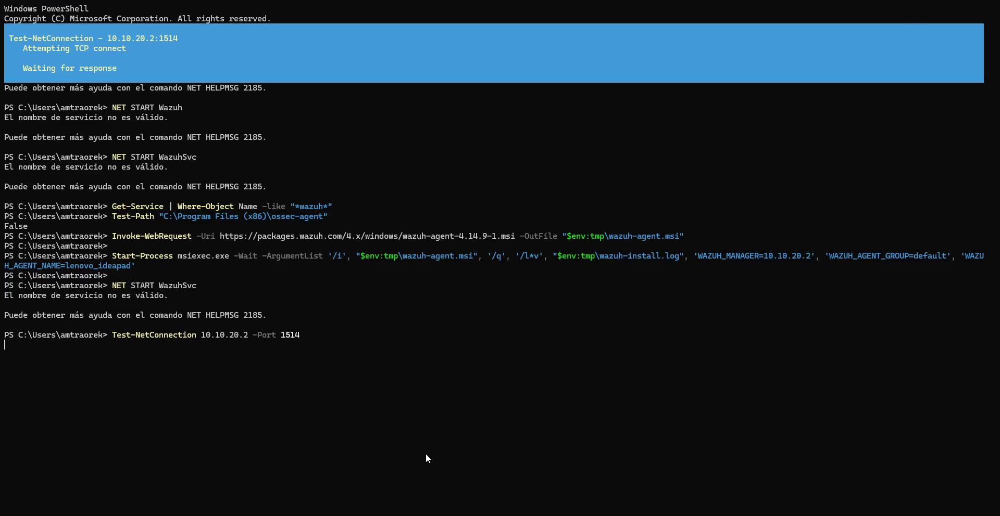
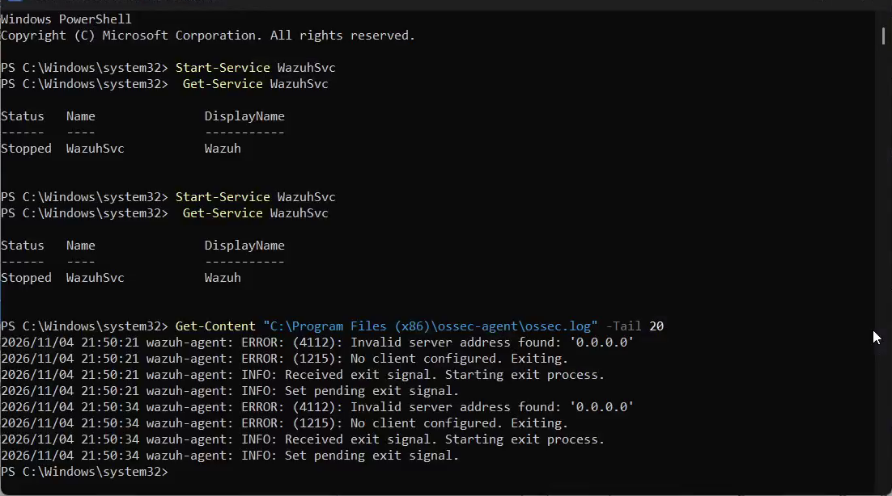
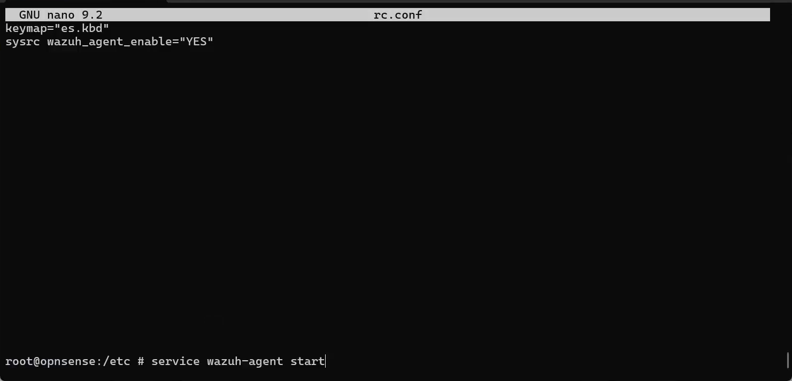
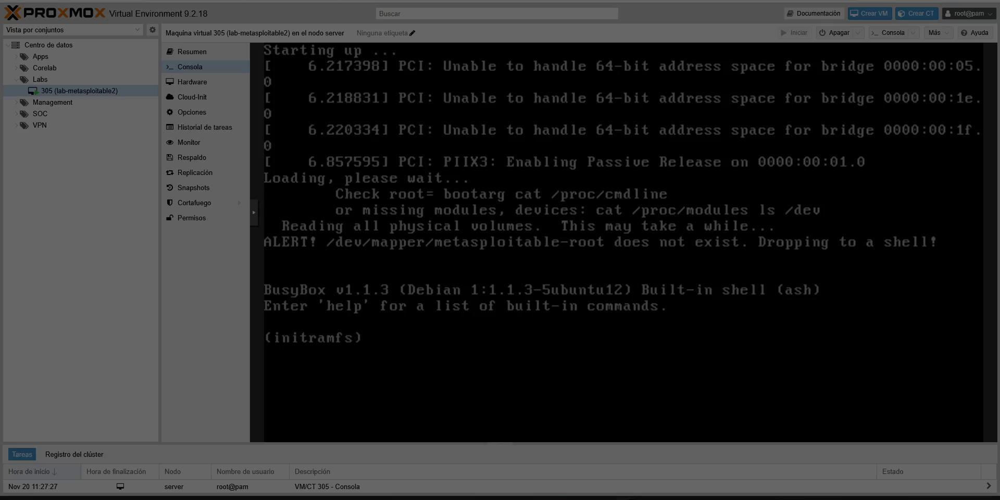

# Resolución de problemas

## Descripción

Recopilación de las incidencias encontradas durante el despliegue y la puesta en marcha del laboratorio, con la causa observada y la comprobación aplicada.

## Objetivo

Documentar los problemas reales del laboratorio y las soluciones que funcionaron, para poder repetir el despliegue y resolver incidencias similares sin partir de cero.

## Incidencias y resolución

### Windows: el servicio del agente no arranca

**Síntoma:** tras instalar el agente MSI, `NET START WazuhSvc` devuelve «El nombre de servicio no es válido» y el servicio permanece detenido.



*Intento de arranque del servicio y comprobación del puerto 1514/TCP.*

Comprobaciones:

```powershell
Get-Service WazuhSvc
Get-Content "C:\Program Files (x86)\ossec-agent\ossec.log" -Tail 20
Test-NetConnection 10.10.20.2 -Port 1514
```

En el log del agente aparecía el error:

```text
ERROR: (4112): Invalid server address found: '0.0.0.0'
ERROR: (1215): No client configured. Exiting.
```



*El agente se instaló sin una dirección de manager válida (`0.0.0.0`).*

**Causa:** el agente se instaló sin la variable `WAZUH_MANAGER` o con un valor incorrecto, por lo que quedó configurado con la dirección por defecto.

**Resolución:** reinstalar el paquete indicando el manager correcto:

```powershell
Start-Process msiexec.exe -Wait -ArgumentList '/i', "$env:tmp/wazuh-agent.msi", `
  '/q', '/l*v', "$env:tmp/wazuh-install.log", `
  'WAZUH_MANAGER=10.10.20.2', `
  'WAZUH_AGENT_GROUP=default', `
  'WAZUH_AGENT_NAME=DESKTOP-RHQ7Q7DP'
```

También se puede corregir la dirección en `C:\Program Files (x86)\ossec-agent\ossec.conf`, dentro del bloque `<client>`, y reiniciar el servicio:

```xml
<client>
  <server>
    <address>10.10.20.2</address>
    <port>1514</port>
    <protocol>tcp</protocol>
  </server>
</client>
```

```powershell
Restart-Service WazuhSvc
Get-Service WazuhSvc
```

La conectividad al puerto del manager puede validarse antes de reinstalar:

```powershell
Test-NetConnection 10.10.20.2 -Port 1514
```

Si `TcpTestSucceeded` es `False`, revisar la regla NAT y el firewall de OPNsense antes de continuar.

### OPNsense: línea incorrecta en rc.conf

**Síntoma:** el agente de OPNsense no arranca al inicio y `/etc/rc.conf` contiene una línea que no es válida:

```text
sysrc wazuh_agent_enable="YES"
```



*`sysrc` es un comando, no una directiva de configuración.*

**Causa:** se copió el comando completo dentro de `/etc/rc.conf`. El archivo debe contener únicamente la variable:

```text
wazuh_agent_enable="YES"
```

**Resolución:** corregir el archivo o ejecutar el comando desde una shell de OPNsense:

```bash
sysrc wazuh_agent_enable="YES"
service wazuh-agent start
```

Comprobar el estado del agente en el dashboard (**Endpoints**) o en el propio sistema.

### Metasploitable 2: arranque detenido en initramfs

**Síntoma:** tras crear la VM e importar el disco, el arranque se detiene siempre en `initramfs` con el mensaje:

```text
ALERT! /dev/mapper/metasploitable-root does not exist. Dropping to a shell!
```



*El volumen raíz LVM no aparece porque el kernel no reconoce el disco SCSI.*

**Causa:** el kernel 2.6 de Metasploitable 2 no reconoce el disco VirtIO SCSI con la configuración inicial. La VM se recreó varias veces y todas las variantes con `scsi0` fallaban en el mismo punto.

**Resolución:** mover el disco a IDE y arrancar desde él:

```bash
qm set 305 --ide0 local-lvm:vm-305-disk-0
qm set 305 --delete scsi0
qm set 305 --boot order=ide0
```

La configuración final (disco IDE, 512 MB de memoria y red VLAN 30) se muestra en la captura de hardware de [Laboratorio de pruebas](pentesting.md#intentos-fallidos-y-corrección). El procedimiento completo está en la misma página.

### Kali: xrdp no escucha en el puerto 3389

**Síntoma:** después de instalar `xrdp`, `nmap` no muestra el puerto `3389` abierto y `ss -tlnp` no lista el servicio.

**Causa:** el paquete queda instalado, pero el servicio está deshabilitado (`disabled/static`) y no se inicia automáticamente.

**Resolución:**

```bash
sudo systemctl enable --now xrdp
ss -tlnp | grep 3389
nmap -p 3389 10.10.30.3
```

El resultado esperado es `3389/tcp open`. Si el puerto está abierto en Kali pero no se alcanza desde la WAN, revisar la regla NAT y la regla de firewall de OPNsense descritas en [Red y conectividad](network.md#regla-nat-para-kali-linux-xrdp).

### Debian: `sudo` no instalado

**Síntoma:** al ejecutar el instalador de Wazuh con `sudo`, la shell responde:

```text
-bash: sudo: orden no encontrada
```

**Causa:** la instalación mínima de Debian no incluye `sudo`.

**Resolución aplicada:** ejecutar los comandos como `root` (el instalador se lanzó finalmente sin `sudo`).

Alternativa recomendada para un uso habitual:

```bash
apt update
apt install sudo
usermod -aG sudo <usuario>
```

Después de cerrar y abrir sesión, el usuario puede ejecutar comandos administrativos con `sudo`.

### Windows: servicio detenido pese a existir

Si `Get-Service WazuhSvc` muestra el servicio pero no arranca, revisar el log antes de reinstalar:

```powershell
Get-Content "C:\Program Files (x86)\ossec-agent\ossec.log" -Tail 50
```

Los errores de dirección del manager (`4112`, `1215`) se corrigen con los pasos de la primera sección. Los errores de permisos o de red requieren revisar la cuenta del servicio y la conectividad con `10.10.20.2:1514`.

## Verificación

- El servicio del agente aparece como `Running` en Windows.
- El agente figura como `active` en **Endpoints**.
- El log no repite los errores `4112` ni `1215`.
- La conectividad con `10.10.20.2:1514` devuelve `TcpTestSucceeded: True`.
- Metasploitable 2 arranca sin errores de `initramfs` y responde en `10.10.30.5`.
- xrdp escucha en `3389/TCP` y la regla NAT de OPNsense redirige a `10.10.30.3`.

## Documentación relacionada

- [Arquitectura de SecOps Lab](architecture.md)
- [Laboratorio de pruebas](pentesting.md)
- [Instalación de Wazuh](installation.md)
- [Despliegue de agentes](despliegue-agentes.md)
- [Red y conectividad](network.md)
- [Dashboard y detección](dashboard.md)
